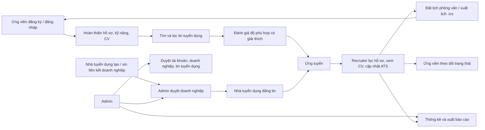
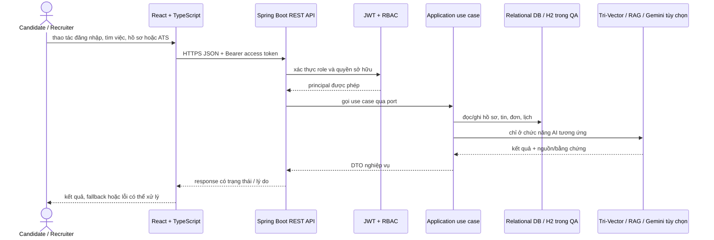

# Kịch bản demo luồng chính TalentBridge

Tài liệu này mô tả demo dùng dữ liệu test/local. Không đưa CV hoặc thông tin cá nhân thật vào bộ kiểm thử. Gemini là tùy chọn: nếu thiếu key, parser/trợ lý dùng fallback và UI phải thể hiện đúng nguồn.

## Luồng nghiệp vụ

## Các bước trình diễn

1. Mở `/register`, tạo Candidate hoặc Recruiter bằng email test, sau đó đăng nhập. Backend cấp phiên JWT; menu và route được giới hạn theo role.
2. Candidate cập nhật hồ sơ, tải CV và kỹ năng. Nếu Gemini có cấu hình, thao tác nhập CV dùng `POST /api/v1/candidates/profile/parse-cv`; nếu không, backend trả kết quả fallback với lý do cụ thể.
3. Candidate tìm tin ở `/jobs`, mở chi tiết, xem mức phù hợp cùng bằng chứng khớp/thiếu, rồi nộp đơn. Endpoint của phần đánh giá là `GET /api/v1/ai/jobs/{jobId}/my-fit`; dữ liệu chỉ thuộc tài khoản Candidate và tin đang hoạt động.
4. Recruiter hoàn thiện hồ sơ, upload avatar bằng tệp hoặc URL, tạo yêu cầu doanh nghiệp hoặc xin gia nhập doanh nghiệp đã xác thực. Tin tuyển dụng chỉ mở sau khi tài khoản liên kết được doanh nghiệp.
5. Recruiter đăng tin, lọc hồ sơ theo từ khóa/giai đoạn/kinh nghiệm, xem CV qua endpoint có Bearer token và quyền sở hữu, cập nhật giai đoạn ATS, ghi nhận nhận xét và xuất CSV.
6. Recruiter đặt lịch phỏng vấn. Có thể mở lịch ngoài khi mạng cho phép hoặc tải `.ics`; API kiểm tra người tham gia và định dạng thời gian theo múi giờ Việt Nam. Candidate xem lịch và trạng thái trong tài khoản.
7. Admin duyệt doanh nghiệp, quản trị tài khoản/tin đăng và theo dõi thống kê API. Trợ lý Admin có thể tạo các báo cáo PNG/Excel/Word theo quyền hiện tại.
8. Dùng trợ lý Candidate/Recruiter để hỏi hướng dẫn. Recruiter có thể yêu cầu số liệu ATS, lọc và tải CSV. Chatbot hỏi đáp knowledge base là luồng RAG; nó chưa tự gọi MCP.

## Luồng kỹ thuật chính

Spring backend tổ chức theo ports/adapters: controller web là adapter vào; use case xử lý nghiệp vụ; port tách hợp đồng; adapter ra kết nối persistence, lưu tệp, Gemini và MCP. QA dùng H2 riêng, Playwright chạy giao diện thật; không ghi dữ liệu test vào production.

## Mốc source để mở khi demo

- `frontend/src/pages/RegisterPage.tsx`, `frontend/src/pages/jobs/JobDetailPage.tsx`, `frontend/src/pages/recruiter/RecruiterJobApplicantsPage.tsx`
- `src/main/java/vn/talentbridge/adapter/in/web/controller/AuthController.java`
- `src/main/java/vn/talentbridge/adapter/in/web/controller/ApplicationController.java`
- `src/main/java/vn/talentbridge/adapter/in/web/controller/CandidateJobFitController.java`
- `src/main/java/vn/talentbridge/adapter/out/ai/TriVectorRagMatchingService.java`
- `src/main/java/vn/talentbridge/adapter/out/ai/GroundedTalentBridgeAssistantAdapter.java`
- `src/main/java/vn/talentbridge/adapter/in/mcp/TalentBridgeMcpConfiguration.java`

MCP theo giao thức [Model Context Protocol Tools](https://modelcontextprotocol.io/specification/2025-11-25/server/tools); nền tảng nghiên cứu AI-KM được ghi rõ tại [tài liệu tích hợp AI](AI_INTEGRATION_STATUS.md).
